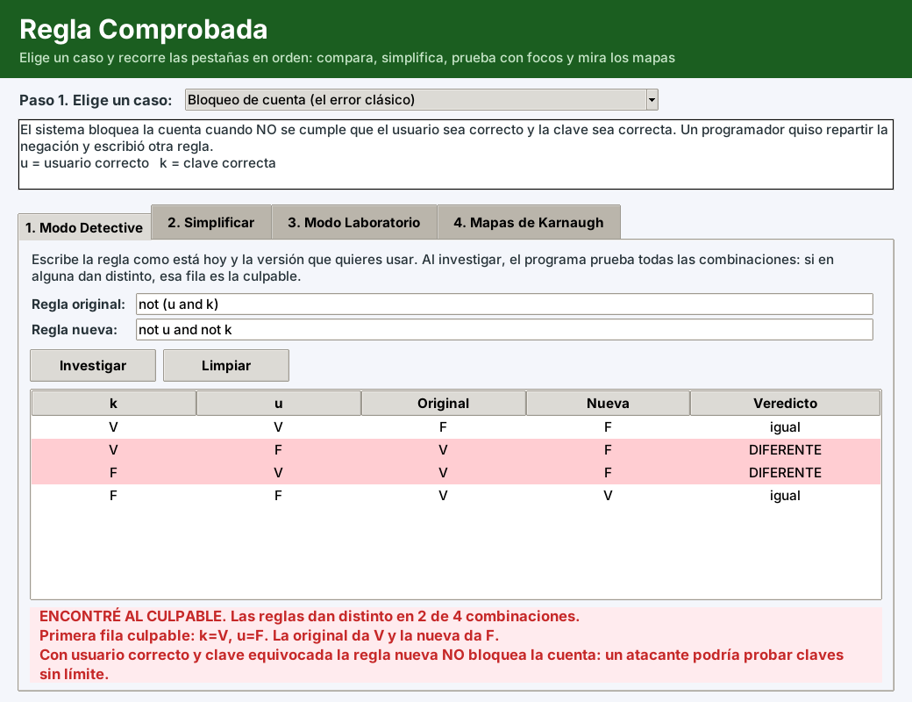
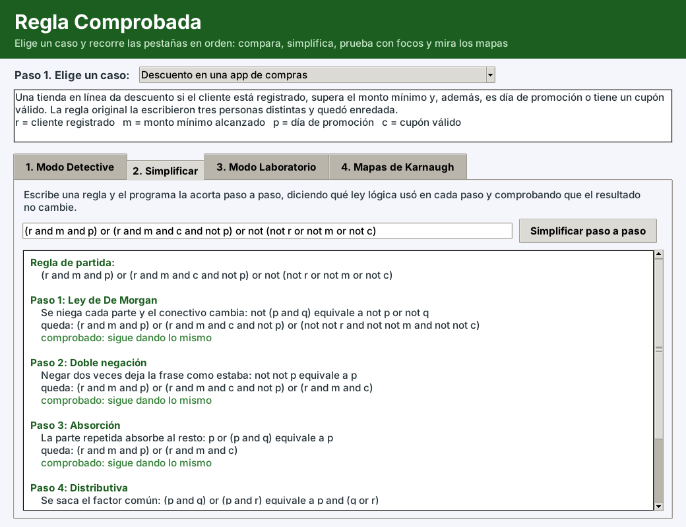
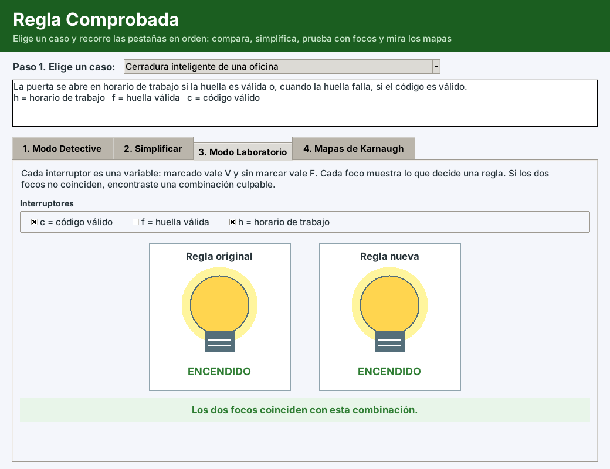
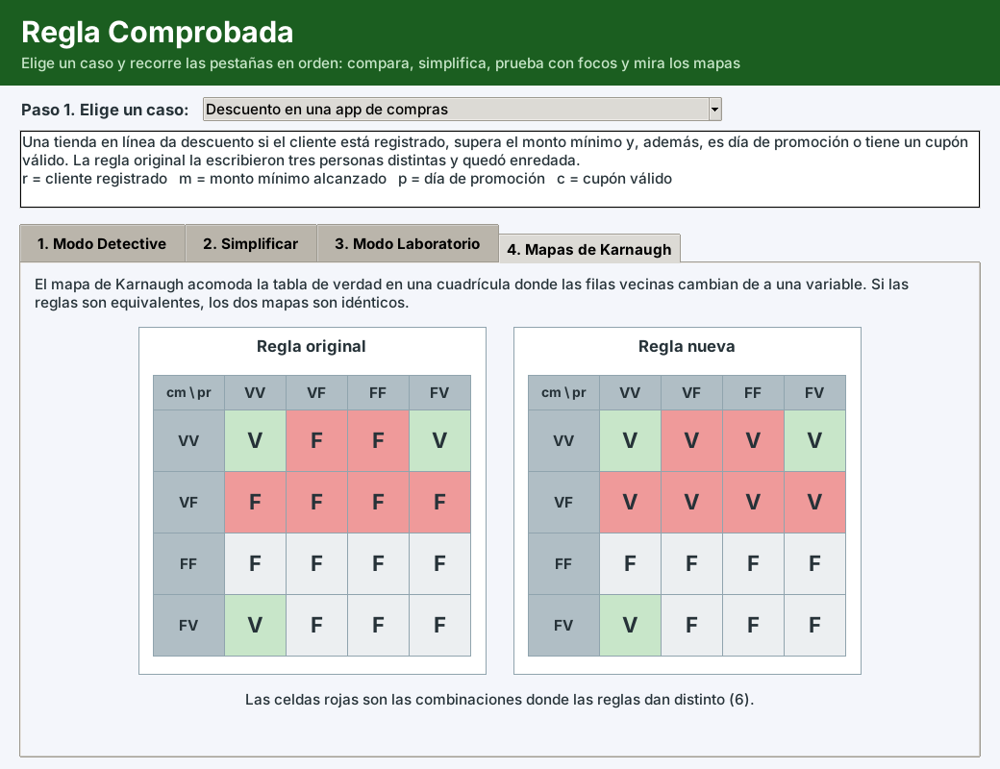

# Regla Comprobada

Aplicación de escritorio en Python que **comprueba si dos versiones de una misma regla lógica dicen realmente lo mismo**, y si no, señala la combinación exacta donde fallan. También simplifica una regla paso a paso, la prueba con interruptores y focos, y dibuja los mapas de Karnaugh de las dos versiones.

Proyecto ABP de la Unidad 1 (Lógica proposicional y funcional) de **Modelos Discretos para la Ingeniería**, Universidad de las Fuerzas Armadas ESPE, NRC 32798, docente Ing. Javier Cevallos, Mgtr.

## Integrantes (Grupo 3)

- Jordy Jair Muela Mera
- Kleber Samir Zambrano Mena


## El problema que resuelve

Las reglas de un sistema (descuentos, permisos, filtros, bloqueos de cuenta) se escriben y se «arreglan» a ojo, y casi nunca se comprueba que la regla nueva haga lo mismo que la vieja. Un caso clásico es el bloqueo de cuenta: escribir `not u and not k` cuando la regla correcta era `not (u and k)`. Las dos reglas coinciden en dos de las cuatro combinaciones, por eso una prueba rápida casi nunca detecta el error. Regla Comprobada prueba todas las combinaciones y marca en rojo las filas donde las reglas se separan.

## Temas de la Unidad 1 que demuestra

1. **Proposiciones y tablas de verdad.** El Modo Detective construye la tabla de verdad de las dos reglas y las compara fila por fila (equivalencia lógica).
2. **Ley de De Morgan.** El simplificador aplica nueve leyes lógicas (De Morgan, doble negación, absorción, distributiva, entre otras), una por paso, indica el nombre de la ley y comprueba después de cada paso que la regla sigue siendo equivalente.
3. **Alfabeto, lenguaje y gramática de las entradas.** Las reglas que escribe el usuario forman un lenguaje con una gramática definida (ver más abajo) que el analizador reconoce de forma descendente recursiva.

Además, los mapas de Karnaugh (código Gray) permiten ver la equivalencia de forma gráfica.

## Capturas

| | |
|---|---|
|  |  |
|  |  |

## Cómo ejecutarlo

Requisitos: Python 3.9 o superior con Tkinter (viene incluido en Windows y macOS; en Linux: `sudo apt install python3-tk`). No hay que instalar ninguna librería adicional.

```
git clone https://github.com/kszambrano3-stack/Proyecto.git
cd Proyecto
python main.py
```

En algunos equipos el comando es `python3 main.py`.

## Cómo usarlo

1. Arriba, elegir un caso de la lista (descuento en una app, notificaciones, cerradura inteligente, bloqueo de cuenta, filtro de correo). Todas las pestañas se llenan solas.
2. **1. Modo Detective:** muestra la tabla de verdad y el veredicto, «Caso cerrado» o «Encontré al culpable», con la primera fila donde las reglas difieren.
3. **2. Simplificar:** acorta la regla paso a paso con el nombre de cada ley y cuenta cuántos operadores se ahorraron.
4. **3. Modo Laboratorio:** cada variable es un interruptor y cada regla es un foco; si los focos no coinciden, esa combinación es culpable.
5. **4. Mapas de Karnaugh:** dibuja los dos mapas lado a lado y pinta de rojo las casillas distintas.

También se pueden escribir reglas propias con `and`, `or`, `not` y paréntesis. Ejemplo: `not (u and k)`.

## Alfabeto, lenguaje y gramática de las entradas

**Alfabeto:** letras, dígitos y guion bajo (para nombres de variables), los paréntesis `(` y `)`, y los símbolos de los conectivos que se indican abajo.

**Gramática** (la precedencia es NO, luego Y, luego O):

```
regla        ::= disyuncion
disyuncion   ::= conjuncion { O conjuncion }
conjuncion   ::= negacion { Y negacion }
negacion     ::= NO negacion | primario
primario     ::= VARIABLE | CONSTANTE | "(" disyuncion ")"

O            ::= "or"  | "||" | "|" | "∨"
Y            ::= "and" | "&&" | "&" | "∧"
NO           ::= "not" | "!" | "~" | "¬"
CONSTANTE    ::= "true" | "false"
VARIABLE     ::= (letra | "_") { letra | dígito | "_" }   (que no sea una palabra reservada)
```

Si la entrada no pertenece al lenguaje (un carácter extraño, un paréntesis sin cerrar, un operador suelto), el analizador muestra un mensaje que explica qué está mal.

## Modelo del sistema

Cada regla se guarda como un **árbol de expresión** inmutable: las hojas son variables o constantes, y los nodos internos son la negación, la conjunción (AND) y la disyunción (OR) con cualquier número de operandos. El simplificador transforma ese árbol aplicando una ley por paso, y el comparador lo evalúa para cada fila de la tabla de verdad. Este árbol es la base para modelar el sistema con un árbol de decisión o un autómata en las siguientes unidades.

## Estructura del código (Modelo - Vista - Controlador)

```
main.py                         punto de entrada
reglacomprobada/
    modelo/                     lógica pura, sin pantalla
        nodo.py                 árbol de expresión
        analizador_expresion.py gramática y lectura de la regla
        simplificador.py        leyes lógicas paso a paso
        comparador_equivalencia.py
        tabla_verdad.py
        mapa_karnaugh.py
        catalogo_escenarios.py  casos precargados
    vista/                      ventana Tkinter, focos y mapas
    controlador/
        controlador_principal.py
pruebas/
    test_modelo.py              pruebas automáticas
```

## Pruebas

```
python -m unittest discover -s pruebas -t .
```

Son 24 pruebas con `unittest`: analizador (notaciones, precedencia, errores y alfabeto), comparador, simplificador (incluye 300 reglas aleatorias que deben quedar equivalentes), mapas de Karnaugh y los cinco casos precargados.

## Plan por unidades

- **Unidad 1 (avance):** analizador, tabla de verdad, Modo Detective, simplificador, laboratorio de focos y mapas de Karnaugh comparados.
- **Unidad 2 (70 %):** mapa de Karnaugh que forma los grupos solo, dibujo del circuito de compuertas, escenarios propios, salida de la regla como condición de Python y de SQL.
- **Unidad 3 (100 %):** interfaz pulida, revisión completa del código, informe final y exposición.

## Referencias

- Rosen, K. H. (2019). *Discrete mathematics and its applications* (8.ª ed.). McGraw-Hill Education.
- Mano, M. M. y Ciletti, M. D. (2018). *Digital design: With an introduction to the Verilog HDL, VHDL, and SystemVerilog* (6.ª ed.). Pearson.
- Karnaugh, M. (1953). The map method for synthesis of combinational logic circuits. *Transactions of the American Institute of Electrical Engineers, Part I: Communication and Electronics, 72*(5), 593–599.
